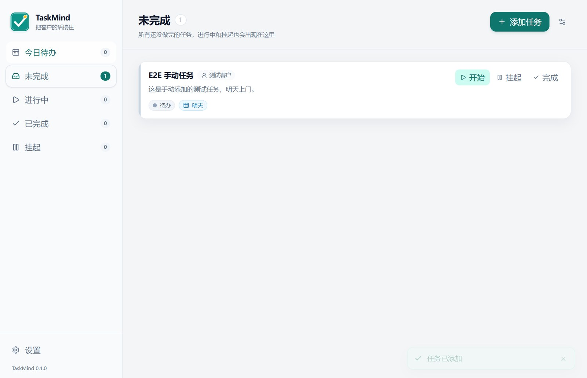
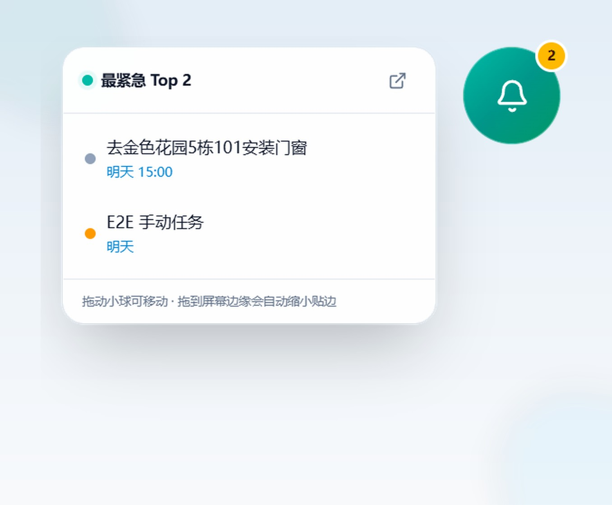
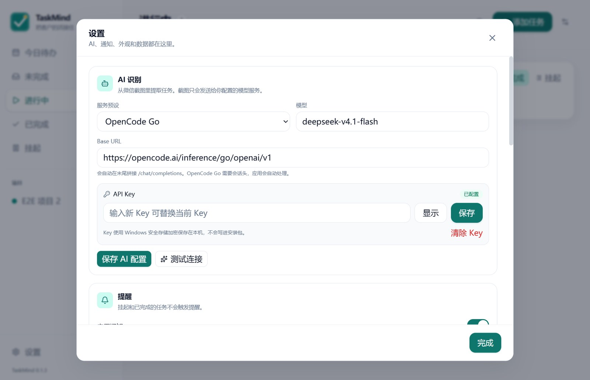
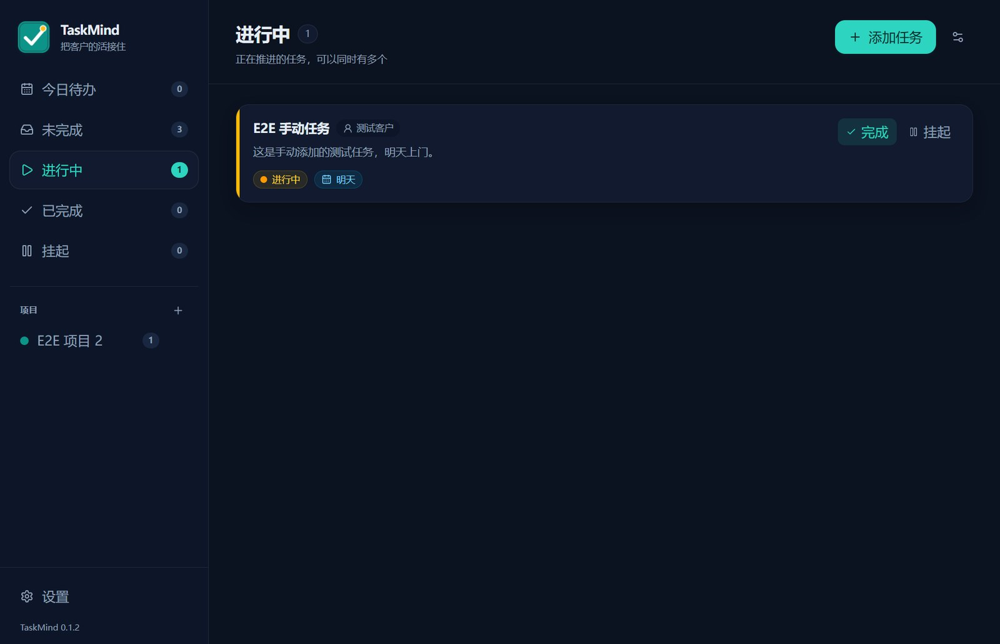

# TaskMind

一个面向 Windows 的本地桌面任务管理器：把微信里的客户任务截图粘进来，AI 识别后生成待办，再用桌面浮球盯住最紧急的 3 件。

> Screenshots use fake test data. 仓库和发布包都不包含任何 API Key、本机设置或用户数据。



## 功能

- **截图变任务**：在软件里 `Ctrl+V` 粘贴微信截图，AI 自动提取任务名称、客户、内容、截止日期、时间、备注，所有字段都可以手动修改。
- **多截图综合分析**：一次可以粘贴多张截图，AI 会综合全部截图提取同一个任务；新增或删除截图后会自动重新识别。
- **按紧急度排**：今日待办、未完成、进行中、已完成、挂起五个视图；逾期任务红色标记。
- **完整状态流**：开始 → 进行中；挂起 → 稍后再做；完成 → 已完成；还原 → 回到完成前状态。允许多个任务同时进行中。
- **截图随手看**：一个任务多张截图，详情页缩略图、全屏查看、缩放切换。
- **桌面浮球**：常驻桌面显示最紧急 3 条，点击直接打开任务和截图；可拖动、可调大小、贴边自动缩小吸附。
- **提醒**：每天 09:00 汇总当天到期和逾期任务，设置具体时间的任务到点再提醒；可在设置中关闭。
- **本地优先**：任务、截图、设置全部保存在本机；API Key 使用 Windows 安全存储加密。
- **其他**：托盘常驻、关闭到托盘、开机自启、单实例、浅色/深色、备份导出/导入。

<p align="center">
  
  
</p>

<p align="center">
  
  
</p>

## 下载和安装

从 [Releases](https://github.com/ErikeYJ/TaskMind/releases) 下载：

- `TaskMind-*-x64.exe`：Windows x64 安装包
- `TaskMind-*-portable.exe`：免安装绿色版

当前版本没有做代码签名，Windows SmartScreen 可能提示，点击「更多信息 → 仍要运行」即可。安装包是 per-user 安装，不需要管理员权限；卸载默认保留 `%APPDATA%\TaskMind` 里的任务数据。

## 第一次使用

1. 启动 TaskMind，按引导填写 AI Key。
2. 默认服务是 **OpenCode Go**，模型 **`deepseek-v4.1-flash`**，Base URL 已预填；也可以改成任意兼容 OpenAI Chat Completions 的视觉模型接口。
3. 没有 Key 也可以使用：手动添加任务、贴截图、管理状态都不受影响，只是不会自动识别截图。
4. 在微信里截图，回到 TaskMind 按 `Ctrl+V`；确认 AI 结果后点「添加任务」。

截图只会发送给你配置的模型服务做识别；任务和截图本身保存在本机。API Key 加密保存在本机，不会写进源码、安装包或备份。

## 数据与隐私

- 数据目录：`%APPDATA%\TaskMind`
- 数据库：`taskmind.db`（SQLite）
- 截图：数据目录下的 `images/`
- 备份：设置页可导出 zip，备份包含数据库、截图和设置，但**不包含 API Key**。
- 没有账号、云同步、遥测或远程日志。
- 项目仓库和 Release 产物不包含任何用户配置。

## 开发

环境要求：

- Windows 10/11 x64
- Node.js >= 22
- pnpm 10
- `better-sqlite3` 需要原生模块构建；Windows 上建议安装 Visual Studio Build Tools（C++）和 Python。Release 产物已经包含重建后的原生模块。

常用命令：

```bash
pnpm install
pnpm dev          # 开发模式
pnpm typecheck
pnpm test         # 单元测试
pnpm e2e          # 构建并运行 Electron E2E（可选 AI 联调）
pnpm dist         # 构建 NSIS 安装包 + 绿色版
```

E2E 如果需要真实 AI 识别，设置环境变量（不要提交到仓库）：

```bash
TASKMIND_AI_KEY=... TEST_IMAGE_PATH=... pnpm e2e
```

没有 Key 时 E2E 会跳过多模态识别部分，其余流程照常测试。

如果 Electron 下载慢，可以在安装时使用镜像：

```bash
ELECTRON_MIRROR=https://npmmirror.com/mirrors/electron/ pnpm install
```

### 技术栈

- Electron + electron-vite
- React + TypeScript + Tailwind CSS
- SQLite / better-sqlite3
- Radix UI
- zod
- Vitest + Playwright Electron E2E

### 目录

```text
src/main      Electron 主进程：数据库、AI、提醒、托盘、窗口、IPC
src/preload   类型化 IPC 桥
src/renderer  React 主界面和浮球
src/shared    共享类型、日期解析、状态规则、schema
tests         Vitest 单元测试
scripts       测试图片和 Electron E2E
docs          截图
```

## 当前限制

- 一张截图默认只提取一个任务。
- 第一版没有云同步、账号体系和手机端。
- AI 识图服务需要支持图片输入。
- 安装包未签名，分享给同事时可能触发 SmartScreen 提示。

## License

[MIT](LICENSE)

Copyright (c) 2026 TaskMind contributors
